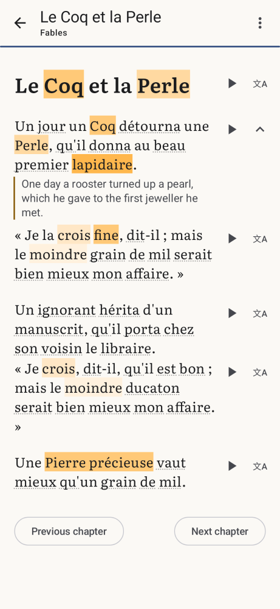
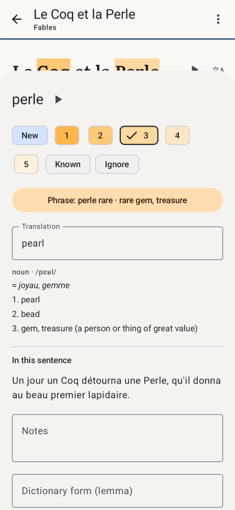
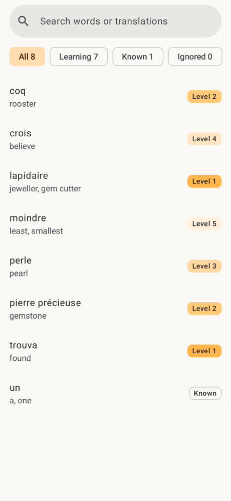
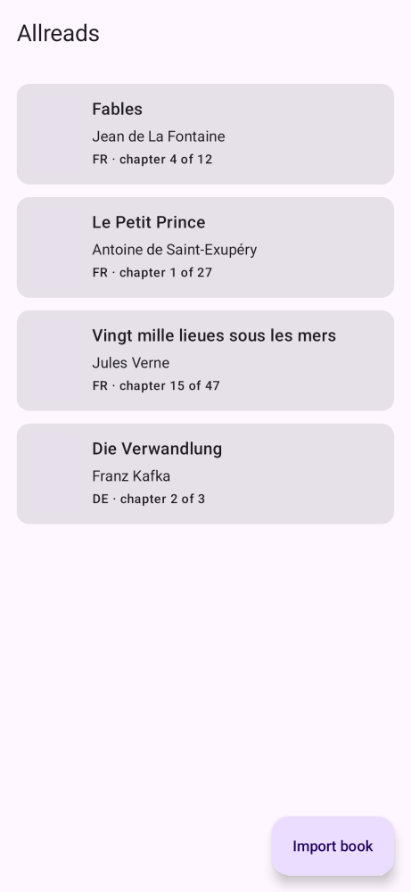
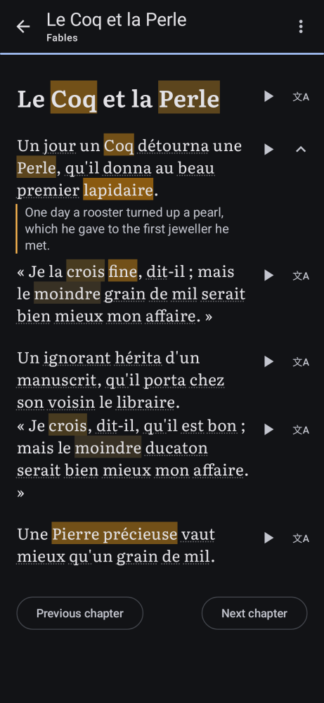
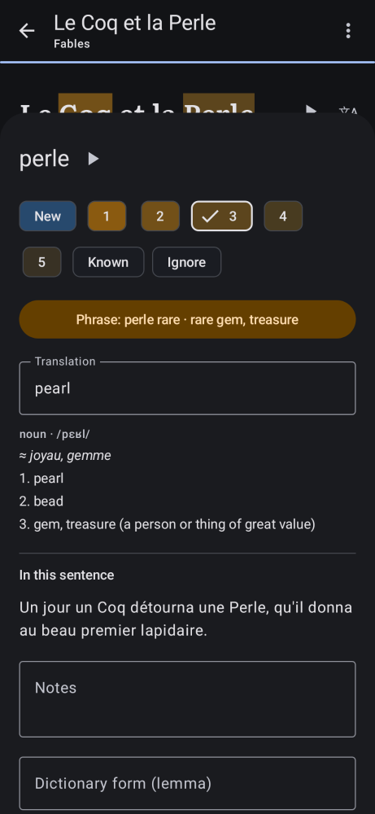
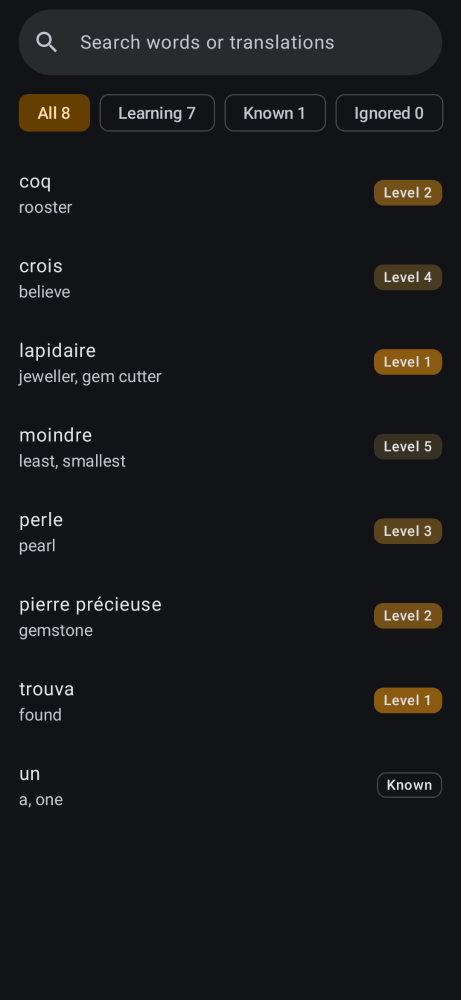
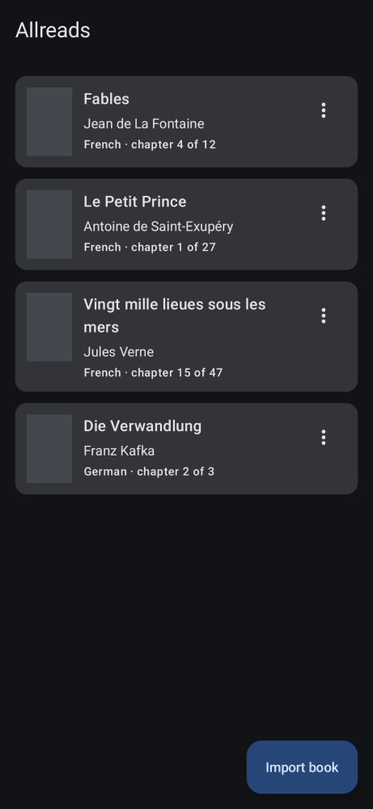

# Allreads

[](https://github.com/ChFlick/Allreads/actions/workflows/ci.yml)
[](LICENSE)

**Learn a language by reading real books.** Allreads is an open-source Android reader for language learners. Import an EPUB, read it with every word coloured by how well you know it, tap a word to look it up, and save it. Saved words become flashcards in [AnkiDroid](https://github.com/ankidroid/Anki-Android), with the sentence you found them in.

It is in the spirit of LingQ and Smart Book, but free, private, and open source.

| Reading | Looking up a word | Your words | Library |
|---|---|---|---|
|  |  |  |  |

<details>
<summary>Dark mode</summary>

| Reading | Looking up a word | Your words | Library |
|---|---|---|---|
|  |  |  |  |

</details>

## Features

- **Read your own books.** Import EPUB and plain-text files. Books open one sentence per line, with a translate button for each sentence, and the app remembers where you stopped.
- **See what you know.** Every word is coloured by its status: new, learning levels 1 to 5, known, or ignored. Mark the rest of a chapter as known in one tap.
- **Look words up in context.** Tap a word for a translation that takes its sentence into account ([DeepL](https://www.deepl.com/pro-api), with your own free key), and for an offline dictionary entry with meanings, part of speech, pronunciation and the dictionary form (*lisait* → *lire*).
- **Phrases.** Save expressions like *pierre précieuse*: they are highlighted wherever they appear. The dictionary suggests phrases around the word you tap, or long-press and drag to select one yourself.
- **Flashcards in AnkiDroid.** Saved words become sentence cards in a deck you choose, with the word in bold, its translation and the sentence's translation, and Anki reads the sentence aloud. Editing a word updates its card; words saved while AnkiDroid is closed wait and go over later.
- **Read aloud.** Hear any sentence or word with your phone's voices, at the speed you like.
- **Offline dictionary.** Download the French → English dictionary (about 11 MB) in Settings, built from Wiktionary. More languages can follow.
- **Languages.** French, German, Spanish and English presets; French has the offline dictionary.

## Privacy

- No accounts, no analytics, no tracking. Your books and words stay on your phone.
- Your DeepL key is stored encrypted with the Android Keystore and only sent to DeepL. Translations go to DeepL only when you ask for them, and are cached so the same text is never sent twice.
- The app only goes online for DeepL, and to fetch the list of offline dictionaries (from this repository's releases) and the ones you download.

## Install

Download the latest APK from [Releases](https://github.com/ChFlick/Allreads/releases) and open it on your phone (Android 8.0 or newer). You may need to allow installing apps from your browser or file manager. Every build from `main` is published there; until v1.0 they are pre-releases.

Then, optionally:

1. **Translations:** get a free [DeepL API key](https://www.deepl.com/pro-api) and add it in Settings.
2. **Flashcards:** install [AnkiDroid](https://play.google.com/store/apps/details?id=com.ichi2.anki), then in Settings → AnkiDroid allow access and pick a deck.
3. **Offline dictionary:** Settings → Dictionaries → Download.

## How it works

Allreads is a thin Android app around a Rust core:

- **Rust core** (`crates/core`): EPUB and text parsing, sentence splitting and word keys per language, the SQLite database, the DeepL client, Anki notes, phrase matching, and the offline dictionary.
- **UniFFI** (`crates/ffi`) generates Kotlin bindings, so the app calls Rust like a Kotlin library through a few coarse calls (for example, a whole chapter of tokens at once).
- **Kotlin and Jetpack Compose** (`android/`): the screens, text-to-speech, and the AnkiDroid connection.
- **dictgen** (`crates/dictgen`): builds the offline dictionaries from [kaikki.org](https://kaikki.org)'s Wiktionary extracts; a GitHub workflow publishes them.

The plan, requirements and decisions are in [`docs/`](docs/).

## Building

See [CONTRIBUTING.md](CONTRIBUTING.md). In short: Rust 1.91 or newer, the Android SDK, and for the APK the NDK and `cargo-ndk`.

```bash
cargo test --workspace
cd android && ./gradlew assembleDebug
```

## Credits

- Language rules adapted from [Lukaisu](https://github.com/HugoFara/lukaisu) (MIT/Unlicense); see [NOTICE](NOTICE).
- Dictionary data from [Wiktionary](https://www.wiktionary.org), extracted by [kaikki.org](https://kaikki.org), under [CC BY-SA 4.0](https://creativecommons.org/licenses/by-sa/4.0/).
- The reading font is [Literata](https://github.com/googlefonts/literata), under the [SIL Open Font License](android/app/src/main/assets/licences/Literata-OFL.txt).
- Translations by [DeepL](https://www.deepl.com), with your own key.
- Flashcards through [AnkiDroid](https://github.com/ankidroid/Anki-Android)'s API.
- Sample text in the screenshots: Jean de La Fontaine, *Le Coq et la Perle* (public domain).

## Licence

MIT. See [LICENSE](LICENSE).
